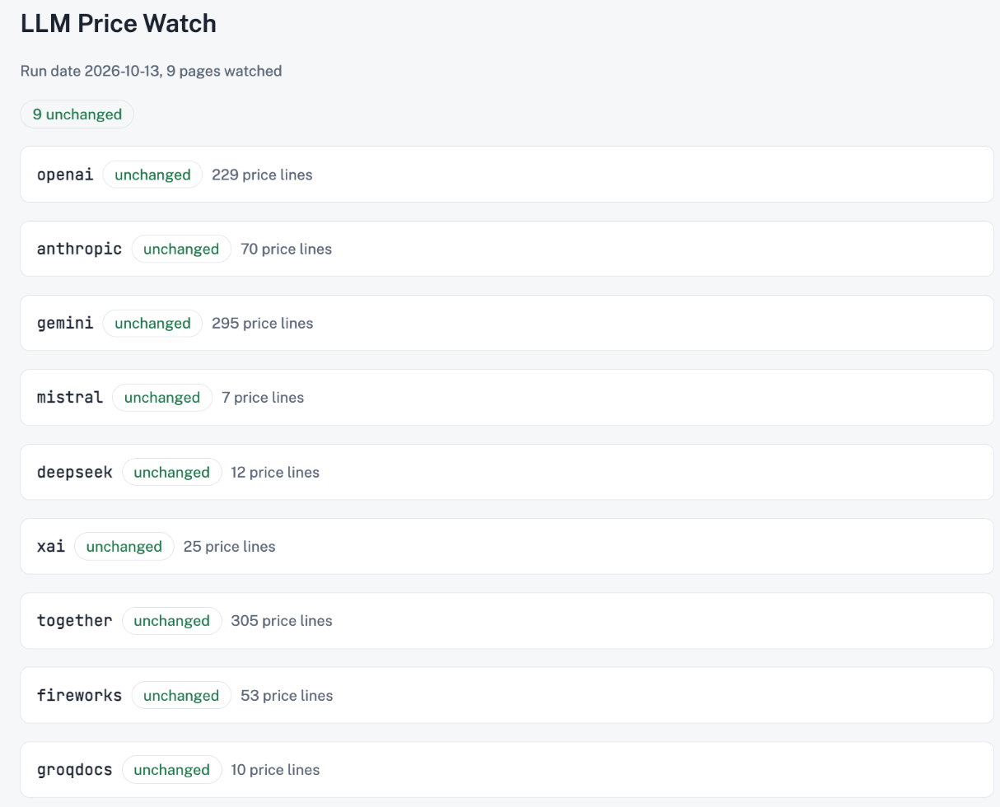

# llm-price-monitor

A daily price monitor for LLM API pricing pages, built as a [Claude Code routine](https://code.claude.com/docs/en/routines). It fetches each page through the [Bright Data Web Unlocker API](https://brightdata.com/products/web-unlocker), checks that it's still the page you expect, and diffs its prices against the last run. When a page changes, Claude reads it through [Bright Data Web MCP](https://brightdata.com/ai/mcp-server) and explains the change in a dated report. The routine then updates a dashboard and commits the result.



## Files

| File | Purpose |
|---|---|
| `monitor.py` | Fetches the pages in `watchlist.json`, checks them, and writes `snapshots/` and `reports/latest.json`. Standard library only. |
| `watchlist.json` | One entry per page: the URL, the expected final URL prefix, text the page must contain, and the minimum number of price lines. Set `"markdown": true` for URLs that already serve Markdown. |
| `dashboard.py` | Renders `reports/latest.json` as an HTML page for a Claude artifact. |
| `.claude/skills/price-monitor/SKILL.md` | The procedure the routine follows. |
| `test_monitor.py` | Offline tests for price extraction and change detection. |

`snapshots/` and `reports/` are created by the first run. The routine commits them, so the next run has something to compare against.

## Run locally

You need Python 3 and a Bright Data API key with a Web Unlocker zone. You can [create a free account](https://brightdata.com/?hs_signup=1).

```bash
export BRIGHTDATA_API_KEY=your-api-key
# export BRIGHTDATA_ZONE=your-zone-name   # only if your zone isn't named web_unlocker
python3 monitor.py
```

Each run prints one status per page:

| Status | Meaning |
|---|---|
| `baseline` | First run for this page. The snapshot is saved. |
| `unchanged` | Same price lines as the last snapshot. |
| `changed` | Price lines were added or removed. The report lists them. |
| `page_drifted` | The page loaded but failed a check: it redirected, lost the expected text, or has too few price lines. |
| `fetch_failed` | No usable page came back. `HTTP Error 401` on every page means the API key isn't set. |

The script exits with code 1 if any page is `page_drifted` or `fetch_failed`. Price extraction matches dollar amounts, so edit `PRICE` in `monitor.py` for other currencies.

Run the tests with `python3 -m unittest`.

## Run as a Claude Code routine

You need a Claude plan that includes [routines](https://code.claude.com/docs/en/routines).

1. **Add Bright Data Web MCP as a connector.** At [claude.ai/customize/connectors](https://claude.ai/customize/connectors), add a custom connector with the URL `https://mcp.brightdata.com/mcp?tools=scrape_batch,scrape_as_markdown`, then sign in.
2. **Create a cloud environment** at claude.ai/code with **Trusted** network access and a [network secret](https://code.claude.com/docs/en/cloud-environments#add-network-secrets) for `api.brightdata.com` (header `Authorization`, prefix `Bearer`). On plans without network secrets, such as Team and Enterprise, use **Custom** network access with `api.brightdata.com` allowed, and set `BRIGHTDATA_API_KEY` as an environment variable.
3. **Fork this repository** and edit `watchlist.json`.
4. **Publish the dashboard.** In a Claude Code session on your fork, run `python3 dashboard.py` and ask Claude to publish `reports/dashboard.html` as an artifact. Replace the artifact URL in step 6 of `SKILL.md` with yours, then commit and push.
5. **Create the routine** at [claude.ai/code/routines](https://claude.ai/code/routines). Use your fork, that environment, and only the Bright Data connector. Set a daily trigger a few minutes past the hour, and the prompt `Run the price-monitor skill.`
6. **Select Run now twice.** The first run reports `baseline` for every page, and the second reports `unchanged`.

## Security

The skill treats page text as untrusted data, as [Bright Data's MCP guidance](https://docs.brightdata.com/products/mcp-server/faqs) recommends:

- The connector exposes only 2 read-only tools, `scrape_batch` and `scrape_as_markdown`.
- Changed pages are read in a subagent, and the report quotes prices only from the diff.
- Text sent with an API trigger is quoted in the report, not followed as instructions.

## License

MIT
